# Navo Phase 1 — current state and experience audit

21 October 2026, Asia/Kathmandu. Existing app at `localhost:8115`, source `4e525f9`. Documentation-only phase: no source/dependency/provider changes and no deployment. Full command results: [test-results](test-results.md); prioritized remedies: [risks](risks.md).

## Overall assessment

The app is substantially more than a static mockup: online geocoding, real walking-route calculation, full-screen route display and selected-date weather worked for the sampled public route. Tested local persistence, GPX processing and navigation math are useful foundations. Navo still cannot be described as an AllTrails-equivalent, Nepal-wide dependable hiking navigator. Main blockers are connected services, verified trail data, offline terrain maps, foreground-only GPS and missing device/field verification.

The audit reused the existing signed-in browser session. It did not retest new-login credentials or email delivery, complete onboarding with invented preferences, request real user GPS, post reviews/messages, create a group, subscribe notifications, delete data or save a new trip. Public place selection can update normal recent-place storage. Earlier completed work remains intact.

## Fresh captured flow

All images below were captured, saved and visually inspected in this run. They are local evidence and have not been uploaded/pushed. Phone captures use 390×844 except initial wider scrolled Home and the explicitly named compact check. Source and UI observations are distinct from field correctness.

### 1. Open Home — healthy for existing authenticated session

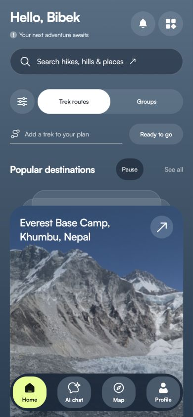

Home displays a real bundled destination photo, name, primary search, slideshow pause and labeled dock. Returning to Home and reloading restored this authenticated session without forcing onboarding. This is not a fresh-account/cross-device onboarding test. Current source also has completion-merging/storage tests and an optional setup path; do not report the old onboarding loop as reproduced now.

UX: Home has several competing planning entry points and a long page below the photo. “Ready to go,” day hike, trips, walking adventures, AI itinerary and copilot need a clearer shared lifecycle. Fixed dock covers part of image; essential controls must remain clear of it on all devices. The initial `01-home.png` is a wider scrolled Home observation; use this phone capture for current layout conclusions.

### 2. Search “Pulchowki” — correct first match, mixed relevance

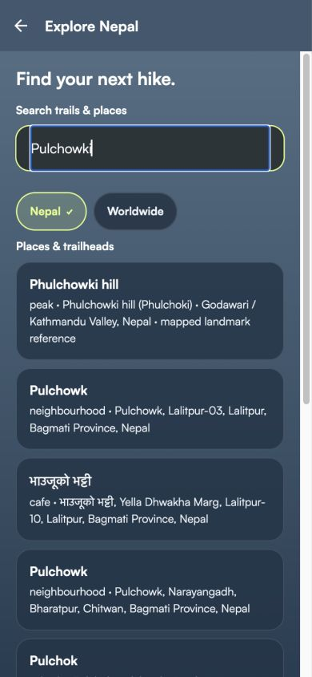

Phulchowki hill appears first with Godawari/Kathmandu Valley context. Selection transfers the landmark to planner. General Photon results below include Pulchowk neighbourhoods and unrelated businesses, so ranking is improved but not trail-only discovery. The detailed-overview count is separate and may be zero even when mapped-place results exist. Nepal/Worldwide scope is explicit. Search should distinguish trail, entrance, summit and settlement with consistent multilingual matching.

### 3. Generate route and expand directions — healthy online preview

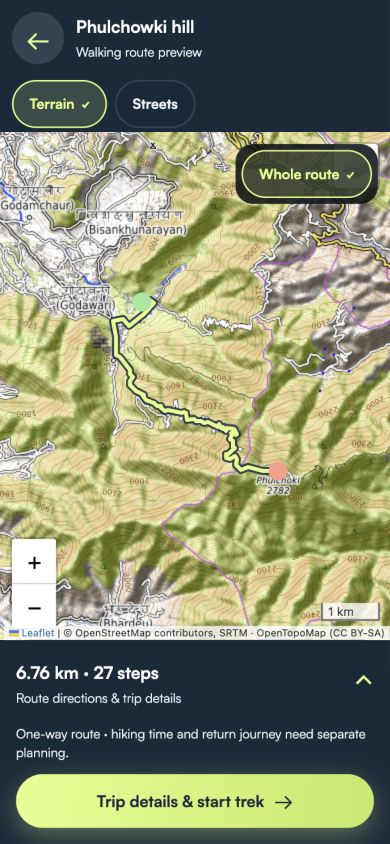

Selected public botanical-garden entry, then pressed Find walking routes. A real provider response opened a full-screen terrain route, **6.76 km and 27 steps**. Expanding directions revealed maneuvers including Godavari Phulchoki Marg; Trip details returned to the review page. This refutes a blanket claim that the current button or Leaflet never works. It does not certify access, route quality or safe summit entry.

Map is prominent, with layer/whole-route controls and one-way warning. Displaying 27 steps is useful but some machine-generated wording such as “End of road right” needs human-readable localization. On long tracks, avoid overwhelming the map with controls, retain uncertainty and provide a nonvisual directions path. Attribution remains visible but small.

### 4. Review route and plan/save — partial journey

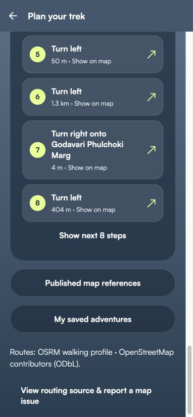

Review page showed 6.76 km one-way, a 1h30m routing baseline, hiking duration unknown, and snapped endpoints 6 m/28 m from selected points. Save walking plan and Start Trek controls rendered. No new plan was saved/started in UI, so persistence success here is test-backed, not an end-to-end claim. A beginner still needs an explicit return/turnaround/transport decision before departure, rather than a warning buried among controls.

### 5. Selected-date weather — healthy sample

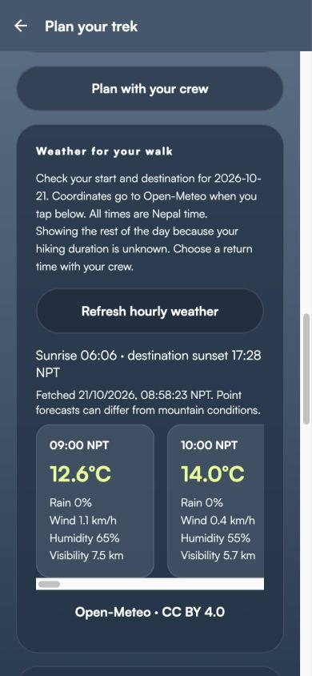

Hourly data loaded for 21 October 2026, with start sunrise 06:06, destination sunset 17:28 NPT, fetched timestamp and source credit. Current code requests start/destination; the visible hourly strip shows destination hours. It must not be described as a measured forecast along every section or an observation at the user's GPS. Long horizontally scrolling hourly cards are usable but add density; a concise summary and accessible full list would help. Far-future forecasts, official warnings and summit microclimate accuracy are not established.

### 6. Stops and viewpoints — failed provider request, controlled recovery

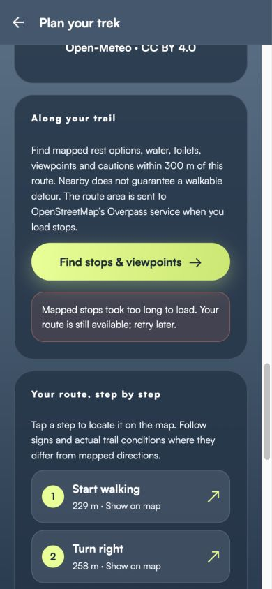

The actual Overpass request timed out. App retained route and showed a retry message instead of inventing facilities. Error handling is a strength; dependable rest/water/hazard recommendations are still not delivered for this sample. A mapped water point does not establish potability; 300 m proximity does not prove a walkable detour. No “safe to wait” or “no danger here” evidence exists.

### 7. Shared groups — blocked

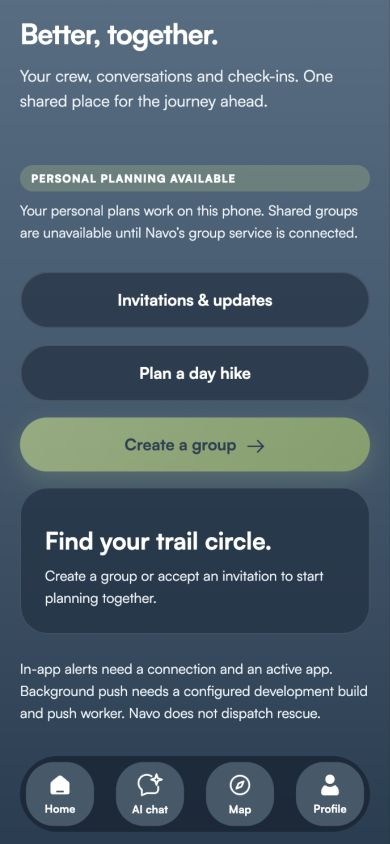

Create group is disabled because shared service is not connected. Explanatory text distinguishes personal plans and internet-dependent alerts. The screen should not become a large dead-end in a public release: either connect and test crews, or present the available personal flow as primary with clear group availability. Backend presence/tests do not make the feature operational.

### 8. AI — blocked by account readiness

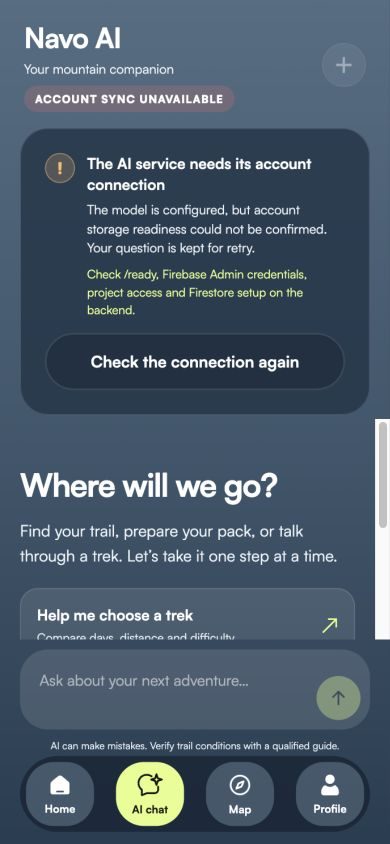

Browser reports ACCOUNT SYNC UNAVAILABLE: model configured, account storage readiness not confirmed. Shell service probe separately failed/timed out; different surfaces can have different connectivity, so this is not proof that the model key is bad or that all servers are stopped. No question was sent and no live answer verified. Current disabled send and retained question/retry flow is preferable to fake replies. Developer-only remediation text currently appears in this development build; production should retain user-understandable status and actionable support.

### 9. Trek overview/gallery — healthy display, approximate content

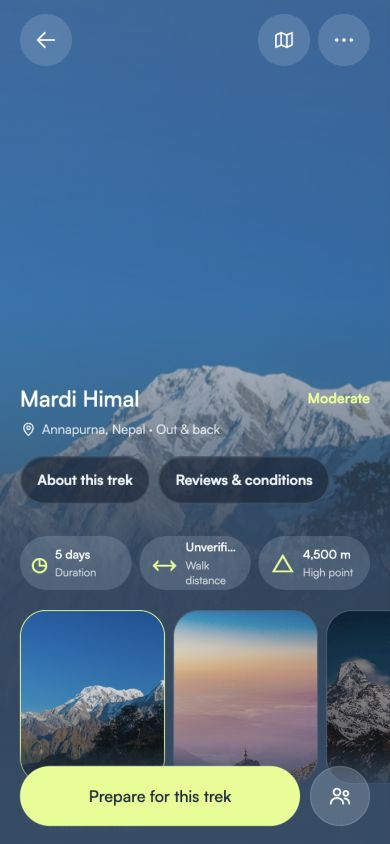

Mardi image loads; selecting High Camp morning changes displayed image and photographer credit. Three distinct bundled images are defined per trek in `data/trek-photos.ts`, with source/license records. Thus the earlier missing/repeated-image complaint is not reproduced in this sampled current gallery. The essential “Unverified” distance label truncates at 390px; that status must remain fully readable. Static 5-day duration/difficulty/high-point labels and sparse elevations are planning references, not validated navigation metrics. Reviews show account-connection recovery, not a verified live community feed.

### 10. Offline screen — honest scope, essential capability missing

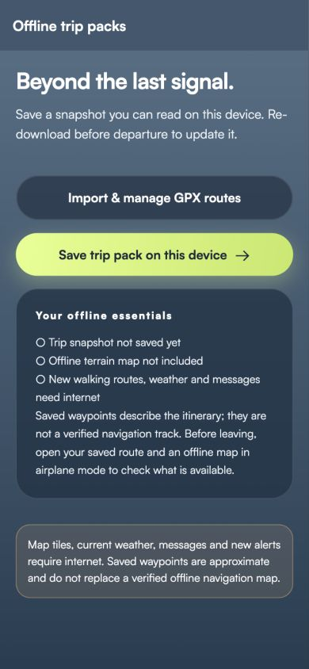

Interface explicitly says offline terrain map not included. Save is a trip snapshot, not a basemap package. No Save was pressed. New routes/weather/messages require connectivity. A user expecting remote-area navigation needs actual downloaded surrounding geography, readable directions and cold-start testing. An online external published-map link is supplementary research, not an offline download or licensed route import.

## Requested journey health at a glance

| Journey | Health |
| --- | --- |
| App/onboarding | Existing session/reload healthy; new/cross-device setup unverified |
| Search | Sample works; coverage/relevance partial |
| Trail details | Sample display/gallery works; facts approximate |
| Map route | Sample online provider route works |
| Metrics | Distance works; elevation/hiking ETA incomplete |
| Save trip | Source/unit-tested; no new UI save in audit |
| GPS | Implemented foreground; device unverified |
| Follow/deviate | Math tested; hike/device unverified |
| Offline download | Snapshot/line partial; terrain packages absent |
| Resume | Checkpoint tests pass; physical restart/offline unverified |

## Nepal-specific readiness

Current landmark aliases include Phulchowki/Shivapuri/Dhap Dam/Budhanilkantha and other regional references; their source comment says OSM/Photon checked 14 October, **not surveyed trails or access guarantees**. No nationwide verified track catalogue, structured seasonal closure/park permit feed, dependable water/stay/transport inventory or live hazard coverage was found. Permit strings and best seasons must be dated, attributed and jurisdiction-specific before public reliance. Treat source-linked OSM landmarks as references, user GPX as unverified and existing catalogue lines as illustrative.

[Roadmap](upgrade-roadmap.md) identifies official NTB, DHM and park/conservation authority research starting points. No new geographic facts, verified emergency numbers or entry permissions were invented during audit.

## Accessibility and performance limits

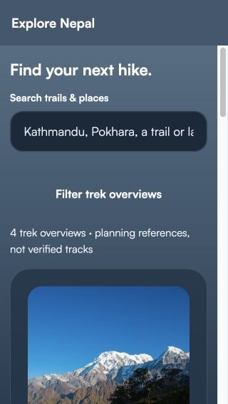

The fresh compact discovery check measured `clientWidth: 320`, `scrollWidth: 320`, `clientHeight: 568`: no document-level horizontal overflow in this sampled state. The search placeholder truncates, while its visible label remains readable. This does not prove all pages reflow or that native large-font layouts pass.

Positive source controls include semantic labels, disabled/busy states, reduced-motion handling, safe-area insets and width/font-scale layout helper. Screenshots establish visible readability risks only. VoiceOver/TalkBack, keyboard order/focus, contrast ratios, large Dynamic Type, native map accessibility and battery/memory behavior require separate testing. Large geometry can still cause linear per-fix work and bridge/rendering cost despite separated moving/static payloads. Do not label the application accessible or performance-ready from exports/screenshots alone.

## Readiness decision

Continue as a clearly scoped development/limited beta preview. Do not promise verified Nepal-wide outdoor navigation, offline maps, continuous lock-screen tracking, working shared services or rescue response. Review the seven P1 issues and P2 usability/data risks before authorizing Phase 2. This audit stops at documentation.
