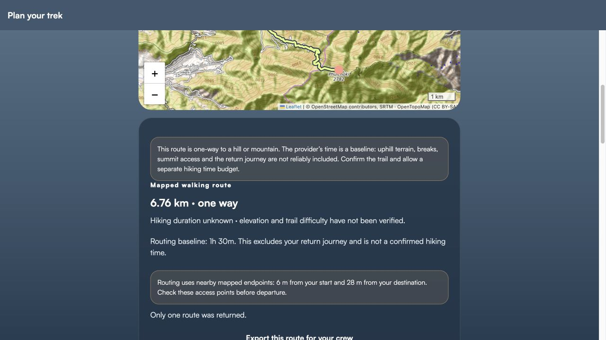

# Phase 2A — geographic data and Phulchowki route audit

21 October 2026; source `4e525f9`. Evidence labels: **Verified** = run/read against actual artifact/provider; **Code inference** = inspected implementation; **Unverified** = no adequate independent/field evidence; **Blocked** = specific provider/prerequisite failure. No route was published, marked verified or added to application data.

## Main conclusion

The reproduced 6.76 km/27-step Phulchowki line is **credible as an OSRM network-derived route**, not invented coordinates or a line joining catalogue stops. Its vertices exactly match a fresh OSRM response. It is **not established as a locally verified hiking trail, lawful summit approach, safe route or complete return itinerary**. Independent path/access-tag comparison was blocked and no field survey took place.

## End-to-end data lineage

1. `PlaceSearch.tsx` merges local `places/hiking-references.ts` aliases with Photon results, normally Nepal scoped. The reference for Pulchowki/Phulchowki/Phulchoki points to **OSM node 3490869705**, a peak, at latitude **27.5710397**, longitude **85.4067119**. This is a destination landmark, not a surveyed trailhead.
2. **Verified:** official OSM node JSON returned HTTP 200, node version **4**, timestamp **2023-10-10T08:48:20Z**, same coordinates, `name=Phulchoki`, `natural=peak`, `ele=2782`. This validates the reference against current returned OSM data, not the elevation's survey accuracy or access. Source: [OSM object](https://www.openstreetmap.org/node/3490869705), [API record](https://api.openstreetmap.org/api/0.6/node/3490869705.json).
3. Selected that reference through the app, then selected the existing public recent result “Entry national botanical garden” as origin. No personal GPS was requested. Place selection can update normal local recent-place state; no trip was saved or started.
4. `trek-plan.tsx` → `resolveWalkingOrigin` → `calculateWalkingRoutes`: sends selected coordinates/stops to configured OSRM foot service. GeoJSON `[longitude,latitude]` becomes app coordinate objects; Leaflet receives `[latitude,longitude]`. This sample does **not** use `data/treks.ts` illustrative Mardi/ABC/Langtang/Everest lines.
5. Development fallback is `https://routing.openstreetmap.de/routed-foot`. App asks for full geometry, steps and alternatives. Decoder validates coordinates/limits/endpoints, <=200 m input snaps, line endpoints within 50 m of returned snaps and required legs/directions. It sets ascent/descent to null. Production requires a configured service; a `/foot/` URL string alone does not independently validate the deployed routing profile.
6. `FullRouteMap.tsx` and Leaflet document show the selected route. The new app request returned **one option**, 6.76 km, 27 instructions. Review UI discloses one-way scope, baseline/unknown hiking time and 6 m/28 m input snap offsets. Exported the route through the actual app control; no private track or user identity was exported.

OSRM documents that transport behavior is determined by its data-preparation profile, not merely a request-path label; confirm the deployed profile/version in production. [OSRM API](https://project-osrm.org/docs/v5.24.0/api/).

## Reproduced geometry measurements

Public sample evidence is under [evidence/phase-2a](evidence/phase-2a/geometry-summary.json):

| Measurement | Result / classification |
| --- | --- |
| UI route | **Verified:** 6.76 km, 27 steps, one-way |
| Export | **Verified:** 12,760 bytes, one segment, **269 vertices**, zero `<ele>` samples |
| Export geometry Haversine sum | **Verified computation:** **6,760.06 m** |
| Largest adjacent-point separation | **Verified computation:** **203.66 m**; no claim that geometry between these vertices was surveyed |
| Export snapped start | **27.597047, 85.383258**, public network point; exact original selected entrance coordinate was not separately captured |
| Export snapped end | **27.571287, 85.406692**; peak itself remains about 28 m away per UI |
| Fresh OSRM request at these snapped endpoints | **Verified:** HTTP 200/Ok, one route, **6,756.6 m**, **5,405.3 s**, 269 vertices, 27 steps and 269 node annotations |
| Export versus fresh OSRM coordinates | **Verified:** all 269 coordinate pairs exactly equal |
| Independent geometry/provider difference | **3.46 m**, approximately 0.05%; compatible numerical/method difference, not evidence of field accuracy |
| Provider step sums | **6,756.7 m**, **5,405.3 s**; rounding explains 0.1 m distance difference |
| Effective provider speed | **4.5 km/h** for this response; not an independently calibrated mountain hiking pace |
| Named route steps | Godavari Phulchoki Marg; many steps unnamed. A route/road name is not an access guarantee. |

The fresh annotated response used **snapped export endpoints**, not a reconstructed original private/start request. It confirms geometry provenance. It does not establish that the exact earlier Phase 1 HTTP response was retained or identical historically. Phase 1 did not preserve that raw response. Both fresh UI and fresh API again show the same rounded route statistics.

Artifacts: [GPX](evidence/phase-2a/phulchowki-reproduced-route.gpx), [geometry summary](evidence/phase-2a/geometry-summary.json), [cross-check](evidence/phase-2a/geometry-cross-check.json), [public OSRM response](evidence/phase-2a/osrm-public-response.json), [request/timestamp/hash](evidence/phase-2a/osrm-probe-summary.json). GPX SHA256: `0d232f499e002991daf68b767dc21290d34773b36a81364a32e1fc3675b7c37c`. OSM-derived evidence needs source/license attribution; these audit files are not newly certified trails.

## What remains unknown or blocked

- **Blocked:** one focused Photon query for the public botanical-garden entrance returned **403** from the command-line network path. The app could reuse its existing public recent place; that does not prove new remote geocoding succeeded in this phase.
- **Blocked:** one bounded Overpass highway/geometry query around the public route returned **406**. No independent way-level access/foot/surface/sac_scale/seasonal/bridge comparison was obtained. Do not infer those values or bypass a denial by scraping another endpoint.
- **Unverified:** real walkability of each section, usable entrances/exit, gates/park rules, route database freshness/profile revision, construction/landslides/closures, current summit access, safe rest/water, trail surface/grade and complete outward/return itinerary. No downloaded user GPS track or local reviewer confirmation exists for this sample.
- **Code inference:** OSM routing follows the provider's graph rather than terrain intuition; OSM graph connectivity can still include stale/missing/incorrect access data. Peak snap within 200 m verifies geometric proximity only, not a lawful final approach.

## Distance, elevation and time sources

| Mode | Distance | Elevation / profile | Duration / confidence |
| --- | --- | --- | --- |
| Routed Phulchowki sample | OSRM distance; independent polyline check agrees closely | OSRM decoder null ascent/descent; GPX export no elevation. No DEM enrichment found. Topographic raster contours are only background imagery. | Provider 5,405.3 s ≈1h30m; pace multiplier relaxed1.25/normal1/brisk0.85. No reliable terrain/return budget. |
| Four catalogue treks | Sparse illustrative stops; not verified walked distance | Static listed elevations; stop-delta sums/profiles describe those points, not terrain between them | Static suggested days and difficulty, no field validation/date per fact |
| User GPX | Sum Haversine distances within separate segments; gaps not bridged | Uses file `<ele>`; missing any elevation makes ascent/descent unknown; raw delta sums can amplify noise. Source not automatically verified. | `planGPXSegment` assumes 4 km/h and creates no turn instructions; rejects gaps >500 m, but that threshold is not a trail-quality certificate |
| Recorded GPS | Filtered accepted fixes, accuracy/noise/gap/speed checks | Device altitude/optional pressure trend; not authoritative DEM or surveyed route profile | Active foreground time; paused/lost-GPS periods excluded, accuracy/device testing still required |

`remainingHikingDuration` deliberately withholds ETA when elevation is absent or GPX duration is a 4 km/h assumption. Backend chat also suppresses unsupported numeric hiking-time advice; a safety-rule response is not proof of model inference. `routes/elevation-profile.ts` requires all file elevations and samples for rendering; it does not repair source errors.

## Basemap, licensing and disclosure

- **Verified source inspection:** Leaflet 1.9.4 via unpkg, web iframe/native WebView; terrain default OpenTopoMap with OSM/SRTM and CC BY-SA credit; streets OSM raster; satellite only with configured credited template. No library/provider was changed.
- **Verified UI:** OSM/OSRM route attribution and one-way/uncertainty notices visible. This is a positive disclosure, not an accuracy guarantee.
- **Code inference:** `exportGPX` writes creator/name/geometry/elevation/time, but no source URL, routing profile/data revision, copyright/link or verification metadata. Reimporting a network export as generic user GPX loses provenance. Add a source/rights record later; do not imply `creator=Navo` establishes ownership of source data.
- **Unverified:** complete production licensing compliance, actual dataset version, provider capacity and offline rights. OSM data and public tile hosting are different rights/services; public OSM raster prefetch/offline downloading is prohibited by its usage policy. [OSMF policy](https://operations.osmfoundation.org/policies/tiles/).
- Published commercial PDF/web maps are supplementary references; no permission to copy their geometry/artwork is established merely by linking them.

## Candidate controlled-validation set — research only

| Candidate | Why useful | Missing prerequisite before field/navigation approval |
| --- | --- | --- |
| Godawari entrance → Phulchowki | Existing reproduced route; hill/summit snap and duration risk | Confirm intended public entrance, allowed route/access, outward/return track, local review/elevation |
| Approved Budhanilkantha-area park entrance → Nagi Gompa/Shivapuri | Existing landmark references; park access and branching paths | Exact lawful entrance/permits, authorized variant and turnaround, licensed full geometry |
| Sundarijal → Dhap-area approved route | Existing regional references; remote facilities/low connectivity | Confirm itinerary/access/seasonal conditions and return, bridge/water/exit review |
| Locally approved Pokhara approach → Sarangkot viewpoint | Existing viewpoint reference; urban approach versus trail distinction | Choose actual walkable entrance/path, avoid assuming road/shortcut quality, licensed field-reviewed track |

These describe validation corridors, not published routes. Do not add distances, times, grades, emergency numbers, safe-water claims or “verified” labels without evidence. Start with one local route and preserve original geometry/source/reviewer/date before scaling Nepal-wide.

## Ranked findings and acceptance gates

| ID / priority | Impact and evidence | Remediation / acceptance |
| --- | --- | --- |
| G1 / P1 | No independent access/field validation; rendered route can mislead a beginner | Licensed full track plus local/authority review, entrance/return/access dates and segment-level uncertainty before field certification |
| G2 / P1 | No source elevation; 1h30m is approximately a flat effective pace | Add a justified elevation/terrain-time method with errors/provenance; keep hiking time unknown until benchmarked; verify return separately |
| G3 / P1 | Provider requests failed 403/406 in sampled command-line tests | Provider-approved capacity, truthful outage states and dated cache; test from actual native/web deployments, without weakening access controls |
| G4 / P2 | GPX export loses provider/license/revision provenance | Preserve source/rights/verification metadata and import/export round-trip tests; no source promotion by reimport |
| G5 / P2 | Landmark and catalogue trail semantics differ | Explicit peak/entrance/route types, consistent multilingual aliases, no all-Nepal coverage claim until measured |

No route was validated as safe or open; no new geographic record was published.
